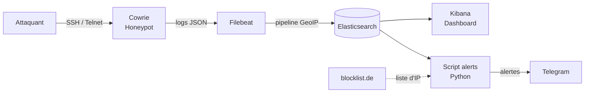

Readme · MD

# 🍯 Honeypot SIEM

Mini-SOC (Security Operations Center) combinant un **honeypot SSH/Telnet (Cowrie)**, une **stack Elastic** (Elasticsearch, Kibana, Filebeat) et des **alertes automatiques Telegram**.

Le système attire les attaquants, enregistre leurs actions, les visualise en temps réel sur un dashboard et alerte dès qu'une activité dangereuse est détectée.

> ⚠️ **Projet éducatif.** À déployer uniquement sur un environnement isolé et sur des machines dont vous êtes propriétaire. Voir la section [Avertissement légal et sécurité](#-avertissement-légal-et-sécurité).

---

## 📑 Sommaire

1. [Fonctionnalités](#-fonctionnalités)
2. [Architecture](#-architecture)
3. [Technologies](#-technologies)
4. [Structure du dépôt](#-structure-du-dépôt)
5. [Prérequis](#-prérequis)
6. [Installation pas à pas](#-installation-pas-à-pas)
7. [Configuration](#-configuration)
8. [Utilisation](#-utilisation)
9. [Règles d'alerte](#-règles-dalerte)
10. [Dashboard Kibana](#-dashboard-kibana)
11. [Simulation d'attaques](#-simulation-dattaques)
12. [Déploiement sur un VPS](#-déploiement-sur-un-vps)
13. [Avertissement légal et sécurité](#-avertissement-légal-et-sécurité)
14. [Dépannage](#-dépannage)
15. [Commandes utiles](#-commandes-utiles)
16. [Améliorations possibles](#-améliorations-possibles)
17. [Auteur](#-auteur)

---

## ✨ Fonctionnalités

- **Honeypot SSH/Telnet** (Cowrie) : simule un serveur Linux et enregistre IP, identifiants testés, commandes tapées et fichiers téléchargés.
- **Collecte centralisée** des logs JSON avec Filebeat.
- **Enrichissement GeoIP** : pays, ville et coordonnées de chaque IP attaquante, via un pipeline d'ingestion Elasticsearch.
- **Dashboard Kibana** : top IP, mots de passe, utilisateurs, types d'événements, courbe temporelle et carte des attaques.
- **Alertes Telegram automatiques** : brute force, commandes dangereuses, IP déjà signalées.
- **Threat intelligence open source** : comparaison avec la liste d'IP malveillantes de blocklist.de, sans clé API.
- **Anti-doublons** : un délai évite l'envoi répété de la même alerte.
- **Simulateur d'attaques** pour tester le dashboard et les alertes.
- **Déploiement en une commande** avec Docker Compose.

---

## 🏗 Architecture



**Flux de données :**

1. Cowrie écoute sur le port `2222` et écrit chaque événement dans `cowrie.json`.
2. Filebeat lit ce fichier, renomme le champ `input` en `command_input` (pour éviter un conflit avec un champ Filebeat) et envoie les événements à Elasticsearch.
3. Le pipeline `cowrie-geoip` ajoute les informations de géolocalisation.
4. Kibana affiche les données ; le script `alerts` les interroge toutes les 60 secondes et envoie les alertes sur Telegram.

---

## 🛠 Technologies

| Composant             | Outil                                       |
| --------------------- | ------------------------------------------- |
| Honeypot              | [Cowrie](https://github.com/cowrie/cowrie)  |
| Collecte de logs      | Filebeat 8.15                               |
| Stockage et recherche | Elasticsearch 8.15                          |
| Visualisation         | Kibana 8.15 (Lens, Maps)                    |
| Alertes               | Python 3, `requests`, `python-dotenv`       |
| Notifications         | Telegram Bot API                            |
| Threat intelligence   | blocklist.de (liste SSH)                    |
| Géolocalisation       | GeoLite2 (processeur GeoIP d'Elasticsearch) |
| Conteneurisation      | Docker et Docker Compose                    |

---

## 📁 Structure du dépôt

```
honeypot-siem/
├── docker-compose.yml            # Orchestration des services
├── filebeat.yml                  # Configuration de la collecte de logs
├── .env.example                  # Modèle de configuration (à copier en .env)
├── .gitignore
├── README.md
├── alerts/
│   ├── Dockerfile                # Image du service d'alertes
│   └── alert.py                  # Règles de détection et envoi Telegram
├── elasticsearch/
│   └── setup_elasticsearch.py    # Crée le pipeline GeoIP et le template d'index
├── kibana/
│   └── dashboard.ndjson          # Export du dashboard (Saved Objects)
├── reports/                      # Service de rapports PDF/CSV (F10)
├── scripts/
│   ├── simulate_attacks.py       # Génère de fausses attaques
│   └── isolate_honeypot.sh       # Blocage des flux sortants du honeypot
└── docs/
    └── (captures d'écran)
```

---

## ✅ Prérequis

- **Docker Desktop** (avec WSL 2 sous Windows) et Docker Compose v2.
- **Python 3.9+** avec `pip` (pour les scripts d'initialisation et de simulation).
- **Git**.
- **4 Go de RAM minimum** alloués à Docker (8 Go conseillés).
- Un **bot Telegram** : créé avec [@BotFather](https://t.me/BotFather).
  Sous Windows, pour limiter la mémoire utilisée par WSL 2, créez `%USERPROFILE%\.wslconfig` :

```ini
[wsl2]
memory=4GB
processors=2
```

Puis exécutez `wsl --shutdown` et relancez Docker Desktop.

---

## 🚀 Installation pas à pas

### 1. Cloner le dépôt

```bash
git clone https://github.com/TON_PSEUDO/honeypot-siem.git
cd honeypot-siem
```

### 2. Créer le bot Telegram

1. Dans Telegram, ouvrez **@BotFather** et envoyez `/newbot`.
2. Choisissez un nom puis un username se terminant par `bot`.
3. Copiez le **token** fourni.
4. Ouvrez la conversation avec **votre** bot, cliquez sur **Start** et envoyez un message.
5. Récupérez votre `chat_id` en ouvrant (en remplaçant `TOKEN`) :

```
   https://api.telegram.org/botTOKEN/getUpdates
```

Le `chat_id` est la valeur de `"chat": {"id": ...}`.

### 3. Configurer l'environnement

```bash
cp .env.example .env        # Windows PowerShell : copy .env.example .env
```

Remplissez `.env` (voir [Configuration](#-configuration)).

### 4. Démarrer la stack

```bash
docker compose up -d --build
docker compose ps
```

Le service `setup` s'exécute une fois (mot de passe `kibana_system`, pipeline GeoIP, templates, politique de rétention) puis s'arrête ; les autres services démarrent ensuite. Comptez 2 minutes.

- Elasticsearch : http://localhost:9200 (identifiants `elastic` / `ELASTIC_PASSWORD`)
- Kibana : http://localhost:5601 (même identifiants — **F9 : accès protégé par login**)

Les ports 9200 et 5601 ne sont liés qu'à `127.0.0.1`. Pour y accéder à distance, utilisez un tunnel SSH ou un reverse proxy TLS.

### 5. Activer l'isolation réseau du honeypot (Linux)

```bash
sudo ./scripts/isolate_honeypot.sh
```

### 6. Vérifier les conteneurs

Les conteneurs `cowrie`, `elasticsearch`, `kibana`, `filebeat`, `alerts` et `reports` doivent être **Up** (`setup` est « Exited (0) » : c'est normal).

### 7. Importer le dashboard

1. Kibana → menu ☰ → **Stack Management → Saved Objects**.
2. **Import** → sélectionnez `kibana/dashboard.ndjson`.
3. Ouvrez **Analytics → Dashboard → Honeypot SOC**.
   Si l'import ne contient pas la Data View, créez-la : **Stack Management → Data Views → Create data view**, nom `cowrie`, pattern `cowrie-*`, champ de temps `@timestamp`.

### 8. Vérifier le fonctionnement

```bash
ssh -p 2222 root@localhost
```

Utilisez n'importe quel mot de passe (Cowrie accepte la plupart d'entre eux), puis tapez quelques commandes, par exemple `ls`, `whoami` et `wget http://example.com/test.sh`.

Résultats attendus :

- les événements apparaissent dans **Kibana → Discover** ;
- un message d'alerte arrive sur Telegram en moins d'une minute ;
- `docker compose logs alerts` affiche `Telegram : 200 ...`.
  Si SSH affiche `REMOTE HOST IDENTIFICATION HAS CHANGED`, exécutez :

```bash
ssh-keygen -R "[localhost]:2222"
```

---

## ⚙️ Configuration

### Fichier `.env`

| Variable           | Description                                                                | Exemple                       |
| ------------------ | -------------------------------------------------------------------------- | ----------------------------- |
| `TELEGRAM_TOKEN`   | Token du bot, fourni par BotFather                                         | `123456:ABC...`               |
| `TELEGRAM_CHAT_ID` | Identifiant de votre conversation Telegram                                 | `987654321`                   |
| `BRUTE_THRESHOLD`  | Nombre de tentatives par minute et par IP déclenchant l'alerte brute force | `50` (mettre `5` pour tester) |
| `ELASTIC_PASSWORD` / `KIBANA_PASSWORD` / `KIBANA_ENCRYPTION_KEY` | Mots de passe et clé de chiffrement (obligatoires) | voir `.env.example` |
| `SMTP_*`, `ALERT_EMAIL_TO` | Envoi des alertes par email (optionnel) | `smtp.gmail.com`, `587` |
| `ABUSEIPDB_KEY`, `ABUSE_THRESHOLD` | Score de réputation AbuseIPDB (optionnel, 80 par défaut) | |
| `SPIKE_FACTOR`, `SPIKE_MIN_EVENTS` | Pic d'activité : x fois la moyenne horaire ET minimum absolu | `3`, `200` |
| `REPORT_INTERVAL_HOURS`, `RETENTION_DAYS` | Fréquence des rapports ; durée de conservation des logs | `24`, `90` |

> 🔒 Ne publiez **jamais** votre `.env`. Si un token a été exposé, révoquez-le avec `/revoke` dans @BotFather.

### Paramètres du script d'alertes (`alerts/alert.py`)

| Paramètre       | Valeur par défaut                                      | Rôle                                                      |
| --------------- | ------------------------------------------------------ | --------------------------------------------------------- |
| `COOLDOWN`      | `600`                                                  | Délai en secondes entre deux alertes identiques           |
| `DANGEROUS`     | `wget`, `curl`, `chmod +x`, `rm -rf`, `nc `, `bash -i` | Mots-clés de commandes dangereuses                        |
| `BLOCKLIST_URL` | liste SSH de blocklist.de                              | Source des IP malveillantes (rechargée toutes les heures) |

### Pipeline d'ingestion et template

`elasticsearch/setup_elasticsearch.py` crée :

- le pipeline **`cowrie-geoip`**, qui ajoute le bloc `geoip` à partir de `src_ip` ;
- le template **`cowrie-template`**, qui déclare `geoip.location` en `geo_point` et force les champs texte en `keyword`.

---

## 📖 Utilisation

### Événements Cowrie principaux

| `eventid`                      | Signification                                          |
| ------------------------------ | ------------------------------------------------------ |
| `cowrie.session.connect`       | Nouvelle connexion                                     |
| `cowrie.login.failed`          | Tentative de connexion échouée                         |
| `cowrie.login.success`         | Connexion acceptée par le honeypot                     |
| `cowrie.command.input`         | Commande tapée par l'attaquant (champ `command_input`) |
| `cowrie.session.file_download` | Fichier téléchargé par l'attaquant                     |

### Recherches utiles dans Kibana (Discover, syntaxe KQL)

```
eventid : "cowrie.command.input"
eventid : "cowrie.login.failed" and src_ip : "1.2.3.4"
geoip.country_name : "China"
```

---

## 🚨 Règles d'alerte

Conformes à la section 7 du cahier des charges. Chaque alerte est aussi archivée dans l'index `honeypot-alerts` (visible dans Kibana, créer une Data View `honeypot-alerts*`).

| Règle (`rule`)        | Condition                                                             | Niveau   | Canaux            |
| --------------------- | --------------------------------------------------------------------- | -------- | ----------------- |
| `brute_force`         | ≥ `BRUTE_THRESHOLD` tentatives de connexion en 1 min depuis une IP    | Élevé    | Telegram          |
| `dangerous_command`   | `wget`, `curl`, `chmod +x`, `rm -rf`, `nc`, `bash -i`… dans la session | Critique | Telegram + email  |
| `malicious_ip`        | Score AbuseIPDB ≥ `ABUSE_THRESHOLD` (ou liste blocklist.de)           | Moyen    | Email             |
| `file_download`       | Dépôt/téléchargement de fichier sur le honeypot                       | Élevé    | Telegram          |
| `activity_spike`      | Événements/heure > `SPIKE_FACTOR` x moyenne des 24 h précédentes      | Moyen    | Email             |

Anti-doublon : une même alerte (règle + IP) n'est renvoyée qu'après `COOLDOWN` secondes ; les commandes et fichiers ne sont alertés qu'une fois par événement, même après redémarrage. Le délai de détection est d'au plus ~30 s + délai de collecte.

> Les règles sont implémentées en Python (`alerts/rules.py`, `alerts/alert.py`) plutôt qu'avec ElastAlert2 prévu au cahier des charges : même résultat, moins de dépendances. Les tests : `cd alerts && pip install pytest && pytest`.

## 📄 Rapports (F10)

Le service `reports` génère toutes les `REPORT_INTERVAL_HOURS` heures un rapport **PDF et CSV** (totaux jour/semaine/mois, top IP, pays, utilisateurs, mots de passe, commandes) dans `reports/output/`.

## 🛡 Isolation et sécurité (exigences non fonctionnelles)

- `scripts/isolate_honeypot.sh` bloque les connexions sortantes initiées par le conteneur Cowrie (règle `DOCKER-USER`). **Test d'isolation :** `docker exec cowrie sh -c 'wget -T 3 -qO- http://example.com || echo BLOQUE'` doit afficher `BLOQUE`.
- Pour l'exposition sur Internet, utilisez une VM/VPS dédiée sans aucune donnée réelle, faites écouter votre vrai SSH sur un autre port, et publiez `HONEYPOT_SSH_PORT=22` seulement après cela.
- Elasticsearch et Kibana exigent un login ; Cowrie tourne sans capabilities Linux avec une limite mémoire.
- **Résilience (test) :** `docker kill cowrie` → le conteneur redémarre seul (`restart: unless-stopped`).

## ✅ Plan de tests (section 9 du cahier des charges)

| Test | Commande | Résultat attendu |
| ---- | -------- | ---------------- |
| Connexion | `ssh -p 2222 root@localhost` | Événement dans Kibana Discover |
| Telnet | `telnet localhost 2223` | Événement `cowrie.session.connect` |
| Brute force | `hydra -l root -P pass.txt -t 4 ssh://IP -s 2222` ou `python scripts/simulate_attacks.py burst` | Alerte Telegram < 1 min |
| Scan de ports | `nmap -sS -p 2222,2223 IP` | Connexions enregistrées |
| Commande dangereuse | `wget http://x` dans la session, ou `simulate_attacks.py command` | Alerte critique Telegram + email |
| Pic d'activité | `python scripts/simulate_attacks.py spike` | Alerte email |
| Résilience / Isolation | voir ci-dessus | Reprise auto / flux bloqué |

Le simulateur lit `ELASTIC_PASSWORD` dans l'environnement : `ELASTIC_PASSWORD=... python scripts/simulate_attacks.py burst`.

## 📊 Dashboard Kibana

Le dashboard **Honeypot SOC** contient :

- Top 10 des IP attaquantes
- Top mots de passe et top utilisateurs testés
- Commandes les plus tapées (champ `command_input`)
- Répartition des types d'événements
- Courbe du nombre d'événements dans le temps
- Carte mondiale des attaques (champ `geoip.location`)
  **Exporter le dashboard après modification :** Stack Management → Saved Objects → cocher le dashboard → **Export** (avec _Include related objects_), puis remplacer `kibana/dashboard.ndjson`.

> ℹ️ En local, toutes les connexions viennent d'une IP privée Docker (par exemple `172.18.0.1`). Les adresses privées ne peuvent pas être géolocalisées : la carte ne se remplit qu'avec des IP publiques, c'est-à-dire sur un serveur exposé ou avec le simulateur.

---

## 🧪 Simulation d'attaques

Le script injecte de faux événements provenant d'IP publiques de plusieurs pays.

```bash
pip install requests

python scripts/simulate_attacks.py              # 60 sessions réparties sur 24 h
python scripts/simulate_attacks.py spread 150   # 150 sessions
python scripts/simulate_attacks.py burst        # brute force immédiat (déclenche l'alerte)
```

Après exécution : Kibana → **Stack Management → Data Views → cowrie → 🔄 (Refresh)**, puis rafraîchissez le dashboard.

**Supprimer les données simulées** (dans Kibana → Dev Tools) :

```json
POST cowrie-*/_delete_by_query
{ "query": { "term": { "simulated": true } } }
```

> Les données simulées portent le champ `simulated: true`. Ne les présentez pas comme de vraies attaques dans un rapport.

### Test avec de vrais outils d'attaque

Contre **votre propre honeypot uniquement** :

```bash
docker run -it --rm kalilinux/kali-rolling bash
apt update && apt install -y hydra
hydra -l root -P pass.txt -s 2222 -t 4 ssh://host.docker.internal
```

---

## ☁️ Déploiement sur un VPS

Pour recevoir de vraies attaques, déployez sur un serveur dédié et jetable (jamais sur votre PC ni votre réseau domestique).

1. **Louer un VPS** Ubuntu 22.04 avec au moins 4 Go de RAM.
2. **Sécuriser l'accès administrateur** : déplacer le vrai SSH sur un autre port (par exemple `22222`), utiliser une clé SSH, activer le pare-feu :

```bash
   sudo ufw allow 22222/tcp
   sudo ufw allow 22/tcp
   sudo ufw enable
```

3. **Installer Docker**, puis cloner le dépôt et créer le `.env`.
4. **Adapter `docker-compose.yml`** :
   - Cowrie écoute sur le port 22 : `"22:2222"`.
   - Elasticsearch et Kibana restent **privés** : `"127.0.0.1:9200:9200"` et `"127.0.0.1:5601:5601"`.
5. Lancer la stack et initialiser Elasticsearch (étapes 4 à 6 de l'installation).
6. **Accéder à Kibana via un tunnel SSH** depuis votre PC :

```bash
   ssh -p 22222 -L 5601:localhost:5601 utilisateur@IP_DU_VPS
```

Puis ouvrir http://localhost:5601.

---

## 🔐 Avertissement légal et sécurité

- Ce projet est **strictement défensif et pédagogique**.
- Ne **jamais** exposer Elasticsearch ou Kibana sur Internet : la sécurité est désactivée dans cette configuration (`xpack.security.enabled=false`).
- Isolez le honeypot du reste de votre réseau et ne placez **aucune donnée réelle** dessus.
- Limitez les connexions sortantes du honeypot avec un pare-feu.
- Les adresses IP collectées sont des **données personnelles** dans certaines juridictions (RGPD). Informez-vous sur les obligations de conservation et de traitement avant un déploiement public.
- N'utilisez les outils d'attaque (Hydra, Nmap...) que contre vos propres systèmes.
- Les secrets (`.env`) ne doivent jamais être versionnés.

---

## 🧯 Dépannage

| Problème                                               | Cause probable                                                   | Solution                                                              |
| ------------------------------------------------------ | ---------------------------------------------------------------- | --------------------------------------------------------------------- |
| `env file ... .env not found`                          | Fichier `.env` absent                                            | `cp .env.example .env` et remplir                                     |
| `volumes.alerts additional properties ... not allowed` | Le service `alerts` est placé après `volumes:`                   | Le déplacer sous `services:`                                          |
| `REMOTE HOST IDENTIFICATION HAS CHANGED`               | Clé SSH de Cowrie régénérée                                      | `ssh-keygen -R "[localhost]:2222"`                                    |
| Kibana : « No results found »                          | Période trop courte                                              | Choisir _Last 24 hours_                                               |
| Panneau « Commandes » vide ou incorrect                | Champ `input` en conflit avec Filebeat                           | Utiliser `command_input` (renommage dans `filebeat.yml`)              |
| Carte vide                                             | IP privées non géolocalisables, ou couche _Documents_ absente    | Utiliser le simulateur et ajouter la couche sur `geoip.location`      |
| `Telegram : 401`                                       | Token incorrect ou révoqué                                       | Vérifier `.env`                                                       |
| `Telegram : 400`                                       | `chat_id` incorrect, ou bot jamais démarré                       | Cliquer sur **Start** dans le bot et revérifier le `chat_id`          |
| Erreur de template (data stream)                       | Template sans `"data_stream": {}` ou ancien data stream existant | `DELETE _data_stream/cowrie-*` puis relancer `setup_elasticsearch.py` |
| Elasticsearch plante (mémoire)                         | RAM insuffisante pour WSL 2                                      | Augmenter `memory` dans `.wslconfig`, ou réduire `ES_JAVA_OPTS`       |

---

## 🧰 Commandes utiles

| Action                                        | Commande                        |
| --------------------------------------------- | ------------------------------- |
| Démarrer                                      | `docker compose up -d`          |
| Reconstruire après modification               | `docker compose up -d --build`  |
| Mettre en pause                               | `docker compose stop`           |
| Reprendre                                     | `docker compose start`          |
| Supprimer les conteneurs (données conservées) | `docker compose down`           |
| **Tout effacer, données comprises**           | `docker compose down -v`        |
| État des services                             | `docker compose ps`             |
| Logs d'un service                             | `docker compose logs -f alerts` |

---

## 🔭 Améliorations possibles

- Blocage automatique des IP malveillantes (pare-feu) avec liste blanche
- Rapport quotidien automatique (résumé par Telegram ou email)
- Association des comportements aux techniques MITRE ATT&CK
- Analyse des fichiers capturés (hash SHA-256, VirusTotal)
- Détection d'anomalies par machine learning (Isolation Forest)
- Honeypots supplémentaires (HTTP, FTP, base de données)
- Authentification et TLS sur Elasticsearch et Kibana
- CI/CD avec GitHub Actions et déploiement automatisé (Ansible)

---

## 👤 Auteur

**Prénom Nom** — Projet de développement et sécurité des réseaux
GitHub : [@TON_PSEUDO](https://github.com/TON_PSEUDO)

---

_Ce projet est fourni à des fins éducatives, sans garantie. L'auteur décline toute responsabilité en cas d'usage inapproprié._

Claude a terminé sa réponse.
